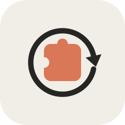
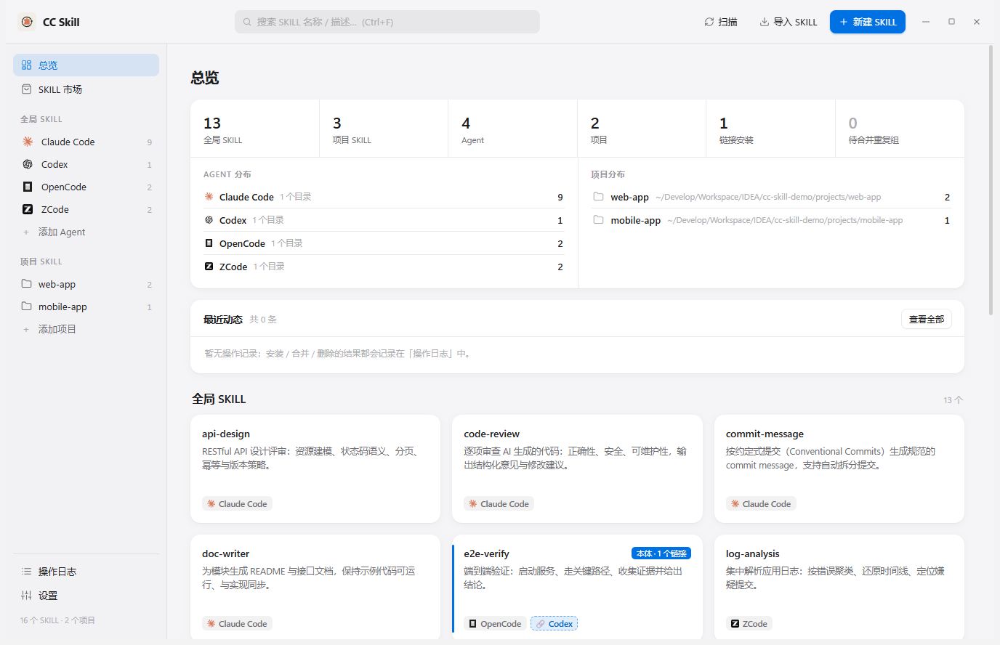

<div align="center">



# CC Skill

**一个桌面应用，统一管理 Claude Code / Codex / OpenCode / OpenClaw / ZCode / Qoder 等 AI Agent 的 SKILL。**

一份实体副本，处处可用：扫描 · 预览 · 编辑 · 安装（副本或链接）· 去重合并 · 项目级管理 · WebDAV 云备份 · 在线更新



[English](README.en.md) · [下载安装包](../../releases/latest) · [报告问题](../../issues) · [功能建议](../../issues)


</div>

---

CC Skill 是一个原生桌面应用（Electron），把散落在各个 AI CLI 目录里的 SKILL 收进一块面板。不用再把同一个 `SKILL.md` 文件夹复制进五六个目录——保留**一份实体副本**，其余位置用目录链接共用，改一处、处处生效。

## 为什么需要它

每个 AI CLI 都读自己的技能目录：

| Agent       | 默认目录           |
| ----------- | ------------------ |
| Claude Code | `~/.claude/skills` |
| Codex       | `~/.codex/skills`  |
| OpenCode    | `~/.opencode/skills` |
| OpenClaw    | `~/.openclaw/skills` |
| ZCode       | `~/.zcode/skills`  |
| Qoder       | `~/.qoder/skills`  |
| （共享约定）| `~/.agents/skills` |

给每个 Agent 都装一份，就意味着 N 份会各自发散的副本。CC Skill 用**副本 / 目录链接两种安装方式**、重复合并、项目级管理和 WebDAV 备份来解决这个问题。

## 功能亮点

- 🔍 **统一扫描**：自动发现各 Agent 目录下的 SKILL（含平铺单文件 `.md`），按 id / 名称 / 目录路径智能识别常见 Agent 并展示品牌标志
- 📄 **详情视图**：Markdown 预览、源码编辑、文件列表；目录下任意文件点开即改，JSON 文件带语法高亮与实时校验（坏配置落不了盘）
- 📦 **随处安装**：复制到任意 Agent / 项目目录，或创建**目录链接**——所有 Agent 共用一份实体，更新即时生效
- 🔗 **链接管理**：详情页列出已安装的链接，支持查看 / 打开 / 卸载 / 新增
- 🧹 **合并重复**：自动识别散落在多个目录的同名 SKILL，一键收敛为「1 份唯一副本 + N 个链接」（移入回收站可找回，失败自动重试并兜底为副本）
- 🗂 **项目级管理**：登记项目目录（如 `your-repo/.claude/skills`），全局 ⇄ 项目双向安装；项目目录强制用副本（Git 仓库中链接有误提交风险）
- 📁 **虚拟分组**：把同类 SKILL（如 `wecomcli-*`）收进自定义分组，视图内折叠成一个文件夹段，同类 SKILL 不再占满整屏；支持**一键收纳**（按名称前缀整族收齐）与**整组安装**到其他 Agent；全局分组在任意 Agent 视图互通可见，项目分组只属于该项目
- 🛒 **SKILL 市场**：内置市场（skills.sh / SkillsMP）按装机量 / star 检索、GitHub 搜索与粘贴链接、自定义索引市场，统一两步安装（下载解压 → 预览勾选 → 装进任意目录）
- ☁️ **WebDAV 备份恢复**：坚果云 / Nextcloud / Alist 均可，云端按机器分目录，跨机器整包恢复；支持定时自动备份（内容有变化才上传）
- 🌐 **网络代理**：跟随系统 / 直连 / 手动配置，市场与更新检测都走它
- 🚀 **在线更新**：应用内检测 GitHub Releases 新版本，一键下载安装包并引导安装，全程无需 token
- 🎨 **四套主题 + 自选强调色**：浅色 / 深色 / 护眼 / 高对比；中英双语界面
- 🧾 **操作日志**：所有操作留痕于应用内，并追加写入 `cc-skill.log`

## 安装

从 [Releases](../../releases/latest) 下载最新的 Windows 安装包（NSIS，支持选择安装目录、自动创建开始菜单与桌面快捷方式），双击安装即可。

> 应用内置在线更新：发布新版本后，设置 → 关于 → 「更新到 vX.Y.Z」一键完成。

### macOS 安装说明（未签名应用）

macOS 版本的 dmg **没有 Apple 开发者签名与公证**（个人项目未购买 Apple Developer Program），首次打开会被 Gatekeeper 拦截，提示「无法打开，因为 Apple 无法检查其是否包含恶意软件」。按下面任一方式放行即可：

**方式一：右键打开（推荐，最简单）**

1. 把 `CC Skill.app` 拖进「应用程序」文件夹（**不要直接在 dmg 里运行**）；
2. 在「应用程序」里**右键**（或按住 Control 点按）CC Skill，选择「打开」；
3. 弹窗里再点一次「打开」——系统会记住这个选择，之后双击即可正常启动。

**方式二：系统设置里放行（方式一无效时）**

1. 双击打开一次，等系统弹出拦截提示后点「完成」关闭；
2. 打开「系统设置 → 隐私与安全性」，在页面底部找到「已阻止使用 CC Skill…」，点「仍要打开」；
3. 输入 Mac 登录密码确认，之后双击即可启动。

**方式三：命令行移除隔离标记（开发者）**

```bash
xattr -dr com.apple.quarantine "/Applications/CC Skill.app"
```

> 如果提示「应用已损坏，无法打开」，几乎都是因为直接在 dmg 里双击运行或下载不完整：先确认已拖进「应用程序」，再用上面的方式放行；仍不行时重新下载安装包。

### 从源码运行

```bash
git clone https://github.com/kaamil95/cc-skill.git
cd cc-skill
npm install           # 国内网络：ELECTRON_MIRROR=https://npmmirror.com/mirrors/electron/ 可加速
npm start             # 开发运行
npm test              # 测试
npm run dist          # 打包 Windows 安装包（dist/*.exe）
npm run dist:mac      # 打包 macOS dmg（必须在 macOS 上执行）
```

环境要求：Windows 10+（链接安装依赖 NTFS）或 macOS 12+、Node.js 22+（开发与测试用；应用运行时用的是 Electron 自带的 Node）。

## 实现原理

- **副本安装**：普通递归复制到目标 Agent 目录。
- **链接安装**：在目标 Agent 目录内创建指向唯一副本的**目录链接**——Windows 用 NTFS 目录联接（`junction`，无需管理员权限、要求同一磁盘），macOS 用符号链接（`symlink`）。删除链接绝不会动唯一副本；删除唯一副本会警告有多少链接将失效；源丢失后的失效链接会被标记、可安全清理。
- **项目级管理**：扫描 `<project>/.claude|.agents|.zcode|.codex|.qoder/skills`，安装目标只列真实存在的目录。项目内安装强制副本。
- **WebDAV 备份**：把 `manifest.json` + 全部实体 SKILL 打成 zip PUT 到本机在云端的目录（每台机器一个子目录）；恢复时任选一台机器的任一份快照，按记录覆盖还原到对应目录。
- **在线更新**：检测走 `github.com` 网页端（ Releases 的 302 地址取版本号、附件页解析安装包直链），刻意不碰匿名额度只有 60 次/小时的 `api.github.com`——代理出口 IP 共享时永远不会被 403。

<details>
<summary><b>多台机器共用一份云端（点击展开）</b></summary>

云端**按机器分目录**：根目录固定为 `cc-skill-sync`，下面每台机器一个子目录，名字是「机器名 + 完整标识」：

```
cc-skill-sync/
  kai-pc-8c2f1d4e-1a2b-4c3d-9e8f-0123456789ab/
    machine.json                       这台机器是谁（改名只改这里，不搬目录）
    cc-skill-backup-20261001-022130.zip
    cc-skill-backup-20261001-022130.zip.json   这一份里有什么
  old-mbp-3d7a1b90-.../
    ...
```

每台机器各自保留最近 10 份。恢复时想用哪台机器、哪一份都行——**用别的机器的备份恢复本机时只还原全局 SKILL**（项目路径是机器相关的）；用本机自己的备份恢复则连项目级 SKILL 一起还原。

重装系统后配置没了，会生成新标识——这时在恢复弹窗里勾一下「这就是这台电脑」，标识就被认领回来，项目配置与它名下的项目 SKILL 一并还原。身份**刻意不靠硬件指纹推断**：能扛过重装的硬件序列号恰恰最容易撞号，而「认错成同一台」不会报错，只会静静地做错事。

恢复时**写入范围由本机把关**：只会写「本机配置里在用的目录」或恢复时列给你确认过的那批目录；备份包自己声明的目录不作数，带 `..` 或非绝对路径的目标一律当非法数据丢掉。备份包里**不含 WebDAV 密码**。

</details>

## 常见问题

**支持 macOS / Linux 吗？**
macOS 12+ 已支持：链接安装用系统 symlink，[Release](../../releases) 提供 dmg。Linux 的 symlink 逻辑已就绪、代码层面可运行，只是还没有打包发布，欢迎 PR。

**我的数据在哪？**
Windows 安装版：`%APPDATA%\CC Skill\`；从便携版 / 旧目录升级会自动迁移。macOS：`~/Library/Application Support/CC Skill/`。测试 / 多实例可用 `CC_SKILL_DATA_DIR` 指到别处。本机文件不会永久删除——删除一律进回收站；但**云端备份的删除是永久的**（WebDAV 没有回收站），所以删除备份 / 机器都会在确认框里写明份数。

**更新检测为什么不需要 GitHub Token？**
检测走 `github.com` 网页端而不是 `api.github.com`——后者的匿名额度按 IP 每小时 60 次，代理出口 IP 一共享就常年 403；网页端没有这套限流。

**WebDAV 密码安全吗？**
密码明文保存在本机配置文件（与大多数同类工具一致）。建议使用服务方签发的应用密码，并妥善保管配置文件。

## 路线图

已完成：

- [x] 定时 / 自动备份 —— 启动 / 每日 / 每周可选，内容有变化才上传
- [x] macOS symlink 支持 —— Release 附带 dmg
- [x] SKILL 市场 / 从 Git 一键安装 —— 内置市场（skills.sh / SkillsMP）+ GitHub 检索 + 自定义索引
- [x] 多语言界面 —— 中文 / English，可跟随系统或手动选择
- [x] Windows NSIS 安装包 + 应用内在线更新

接下来：

- [ ] SKILL 一键更新：记住市场上装过的 SKILL 的来源与版本，一键检查更新
- [ ] Linux 打包（AppImage / deb）—— symlink 逻辑已就绪，缺打包发布
- [ ] 恢复 / 合并前的内容对比：合并重复或恢复备份前先看差异再决定
- [ ] 备份包加密：WebDAV 目录万一被共享，备份内容也不被直接读走
- [ ] 更多云后端：本地目录 / GitHub 仓库 / S3，不止 WebDAV

## 参与贡献

欢迎 Issue 和 PR，参见 [CONTRIBUTING.md](CONTRIBUTING.md)，请遵守[行为准则](CODE_OF_CONDUCT.md)。

如果 CC Skill 对你有帮助，欢迎去 [GitHub](../../) 点个 Star ⭐

## 许可证

[MIT](LICENSE)
